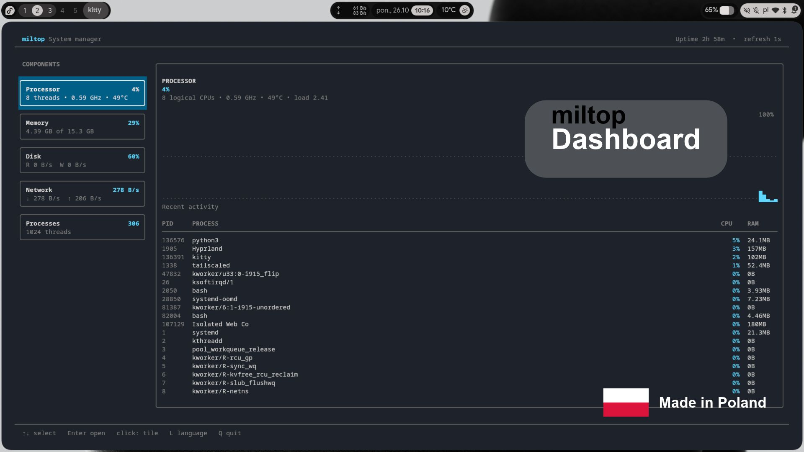
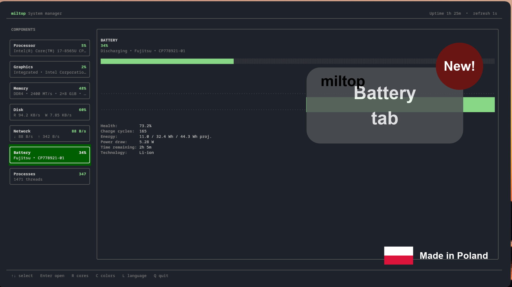
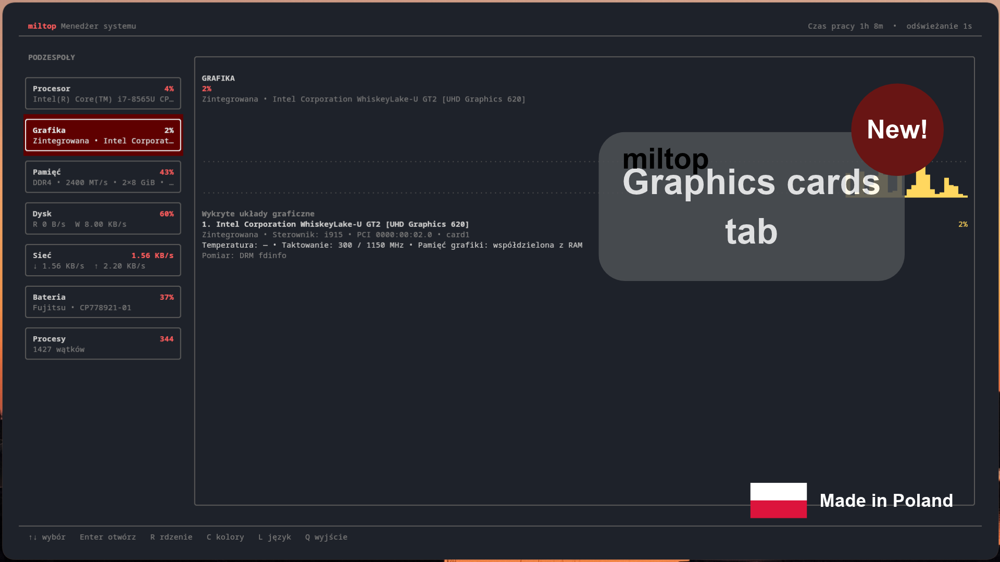
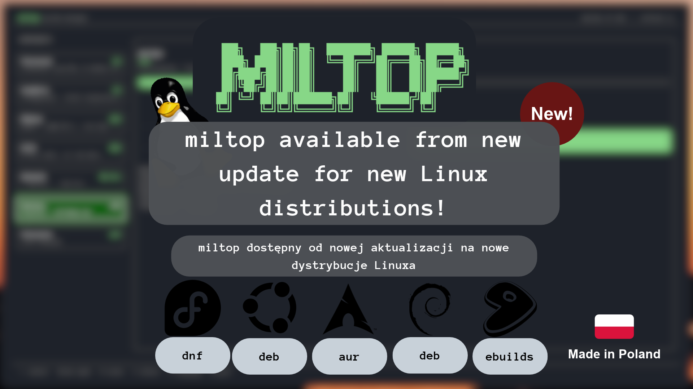

# miltop

**A lightweight, tile-based system monitor for Linux terminals.**

`miltop` presents the most useful information about the processor, memory,
graphics, battery, disk, network and running processes in a clean dashboard. It starts as quickly
as a terminal program, supports mouse and keyboard navigation, and is available
in English and Polish.



## Download packages

Ready-to-install Linux packages are available on the
**[GitHub Releases page](https://github.com/milosz-1710/miltop/releases/latest)**.

| Distribution | Download | Install |
| --- | --- | --- |
| Debian, Ubuntu, Linux Mint | **[Download `.deb`](https://github.com/milosz-1710/miltop/releases/download/v1.3.0/miltop_1.3.0_all.deb)** | `sudo apt install ./miltop_1.3.0_all.deb` |
| Fedora | **[Download `.rpm`](https://github.com/milosz-1710/miltop/releases/download/v1.3.0/miltop-1.3.0-1.noarch.rpm)** | `sudo dnf install ./miltop-1.3.0-1.noarch.rpm` |
| Arch Linux | **[Download `.pkg.tar.zst`](https://github.com/milosz-1710/miltop/releases/download/v1.3.0/miltop-1.3.0-1-any.pkg.tar.zst)** | `sudo pacman -U ./miltop-1.3.0-1-any.pkg.tar.zst` |
| Arch User Repository | **[Download `PKGBUILD`](https://github.com/milosz-1710/miltop/releases/download/v1.3.0/miltop-1.3.0.PKGBUILD)** | Save as `PKGBUILD`, then run `makepkg -si` |
| Gentoo | **[Download ebuild](https://github.com/milosz-1710/miltop/releases/download/v1.3.0/miltop-1.3.0.ebuild)** | Add it to a local overlay and run `ebuild … manifest` |

The packages are architecture-independent: Debian marks this as `all`, while
RPM uses `noarch`.

## What's new in 1.3.0







## Highlights

- tile-based overview of CPU, memory, disk, network and processes;
- live graphs without a permanently busy redraw loop;
- responsive per-core CPU view available with `R`;
- processor model, physical-core/thread topology and current/max frequency;
- integrated/dedicated GPU detection with vendor, full model, utilization,
  temperature, clock, graphics memory, driver and multi-GPU details;
- Intel GPU load fallback through unprivileged DRM engine counters and NVIDIA
  details through the driver's `nvidia-smi` tool;
- battery model, manufacturer, charge, health, cycle count, energy, power draw
  and remaining-time details, with a desktop-friendly no-battery state;
- RAM generation, speed, module layout, manufacturer and part number when
  reported by `inxi` without administrator privileges;
- six persistent interface color themes available from the `C` settings screen;
- interactive process list with live search, configurable CPU/RAM/GPU/energy
  columns and sorting by any visible metric;
- safe process termination: Backspace opens a confirmation and sends SIGTERM;
- English and Polish interface with a first-run language selector;
- keyboard and mouse navigation;
- one-shot text output for scripts with `miltop --snapshot`;
- no background service and no root privileges required.

## Requirements

- Linux;
- Python 3.10 or newer;
- `psutil`;
- `inxi` (optional, enables detailed RAM hardware identification);
- a terminal supporting at least 72×20 characters.

## Installation

### Debian, Ubuntu and Linux Mint

Download the `.deb` file from the latest GitHub release and install it with:

```bash
sudo apt install ./miltop_1.3.0_all.deb
```

### Fedora

Download the `.rpm` file from the latest GitHub release and install it through
DNF:

```bash
sudo dnf install ./miltop-1.3.0-1.noarch.rpm
```

### Arch Linux

Install the ready binary package:

```bash
sudo pacman -U ./miltop-1.3.0-1-any.pkg.tar.zst
```

The release also includes an AUR-compatible `PKGBUILD` and `.SRCINFO`. Put
them in an empty directory and run `makepkg -si` to build locally.

### Gentoo

The release includes `miltop-1.3.0.ebuild` and Gentoo `metadata.xml`. Place
them in `sys-process/miltop/` inside a local overlay, generate the Manifest,
and install:

```bash
ebuild miltop-1.3.0.ebuild manifest
sudo emerge sys-process/miltop
```

### From source

```bash
git clone https://github.com/milosz-1710/miltop.git
cd miltop
python3 -m pip install --user .
miltop
```

For an isolated installation you can use `pipx`:

```bash
pipx install git+https://github.com/milosz-1710/miltop.git
```

All distribution packages install the `miltop` command system-wide and use the
distribution's Python and `psutil` packages.

## Usage

```bash
miltop
miltop --interval 2
miltop --snapshot
miltop --no-color
```

## Controls

| Key | Action |
| --- | --- |
| `↑` / `↓`, `j` / `k` | Select a component or process |
| Mouse click | Select a tile/process or sort by a process-table header |
| `Enter` on Processes | Open the interactive process list |
| `Backspace` | Ask before ending the selected process |
| `R` | Open/close the live processor-core view |
| `C` | Open interface color settings |
| `/` | Search processes by name or PID |
| `S` | Cycle process sorting through visible columns and name |
| `V` | Choose visible process columns: CPU, RAM, GPU, energy impact |
| `L` | Change language |
| `+` / `-` | Increase/decrease refresh frequency |
| `Esc` | Return to the dashboard |
| `Q`, `Ctrl+C` | Quit |

## Polski

`miltop` to lekki, kafelkowy monitor systemu działający bezpośrednio w
terminalu. Pokazuje procesor, pamięć, dysk, sieć oraz procesy. Przy pierwszym
uruchomieniu pozwala wybrać język polski albo angielski i zapamiętuje wybór.

Instalacja oraz sterowanie są opisane powyżej. Język można później zmienić
klawiszem `L`.

## Privacy and permissions

`miltop` reads local system statistics through `psutil`. It does not send
telemetry, does not use the network and does not require administrator access.

## Contributing

Bug reports, ideas, translations and pull requests are welcome. See
[`CONTRIBUTING.md`](CONTRIBUTING.md) before submitting a change.

## License

Copyright © 2026 Miłosz (`milosz-1710`).

Licensed under the GNU General Public License, version 3 or later. See
[`LICENSE`](LICENSE).
