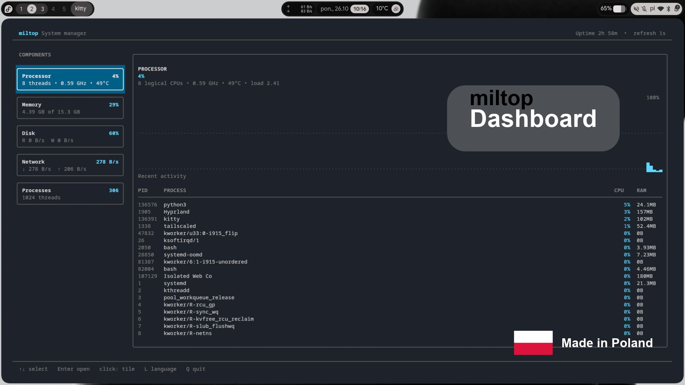

# miltop

**A lightweight, tile-based system monitor for Linux terminals.**

`miltop` presents the most useful information about the processor, memory,
disk, network and running processes in a clean dashboard. It starts as quickly
as a terminal program, supports mouse and keyboard navigation, and is available
in English and Polish.



## Highlights

- tile-based overview of CPU, memory, disk, network and processes;
- live graphs without a permanently busy redraw loop;
- interactive process list with CPU/RAM sorting;
- safe process termination: Backspace opens a confirmation and sends SIGTERM;
- English and Polish interface with a first-run language selector;
- keyboard and mouse navigation;
- one-shot text output for scripts with `miltop --snapshot`;
- no background service and no root privileges required.

## Requirements

- Linux;
- Python 3.10 or newer;
- `psutil`;
- a terminal supporting at least 72×20 characters.

## Installation

### From source (recommended for the first public release)

```bash
git clone https://github.com/milosz-1710/miltop.git
cd miltop
python3 -m pip install --user .
miltop
```

For an isolated installation you can use `pipx`:

```bash
pipx install git+https://github.com/milosz-1710/miltop.git
```

Distribution packages (`.deb`, `.rpm` and an Arch `PKGBUILD`) are planned for
the first packaged release.

## Usage

```bash
miltop
miltop --interval 2
miltop --snapshot
miltop --no-color
```

## Controls

| Key | Action |
| --- | --- |
| `↑` / `↓`, `j` / `k` | Select a component or process |
| Mouse click | Select a tile |
| `Enter` on Processes | Open the interactive process list |
| `Backspace` | Ask before ending the selected process |
| `S` | Sort processes by CPU/RAM |
| `L` | Change language |
| `+` / `-` | Increase/decrease refresh frequency |
| `R` | Refresh immediately |
| `Esc` | Return to the dashboard |
| `Q`, `Ctrl+C` | Quit |

## Polski

`miltop` to lekki, kafelkowy monitor systemu działający bezpośrednio w
terminalu. Pokazuje procesor, pamięć, dysk, sieć oraz procesy. Przy pierwszym
uruchomieniu pozwala wybrać język polski albo angielski i zapamiętuje wybór.

Instalacja oraz sterowanie są opisane powyżej. Język można później zmienić
klawiszem `L`.

## Privacy and permissions

`miltop` reads local system statistics through `psutil`. It does not send
telemetry, does not use the network and does not require administrator access.

## Contributing

Bug reports, ideas, translations and pull requests are welcome. See
[`CONTRIBUTING.md`](CONTRIBUTING.md) before submitting a change.

## License

Copyright © 2026 Miłosz (`milosz-1710`).

Licensed under the GNU General Public License, version 3 or later. See
[`LICENSE`](LICENSE).
