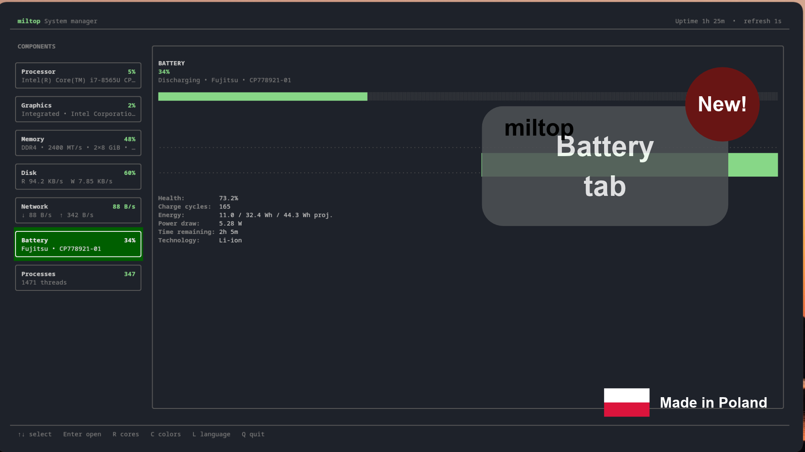
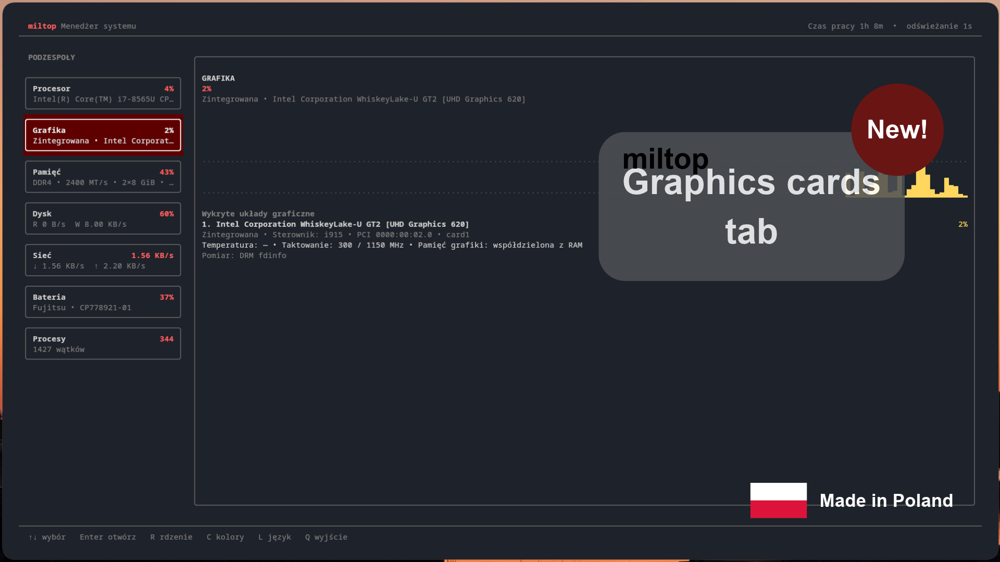
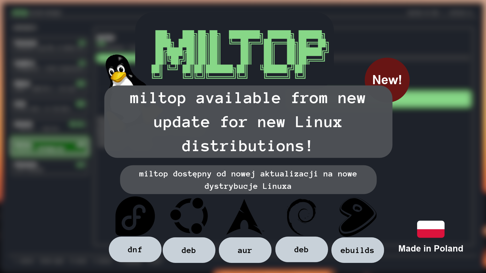

# miltop 1.3.0 — hardware details, faster startup and more Linux distributions

This is the first major feature update to miltop. It keeps the lightweight,
fast terminal experience while adding graphics-card and battery monitoring,
a much stronger process manager, interface themes and ready packages for more
Linux distributions.

## English — what's new

- **Graphics monitoring:** integrated/dedicated detection, manufacturer, full
  model, driver, PCI address, current/max clock, graphics memory and
  temperature whenever the driver exposes it.
- **Working Intel GPU load on more laptops:** miltop uses unprivileged DRM
  engine counters when `gpu_busy_percent` is unavailable.
- **NVIDIA details:** load, temperature, VRAM and clocks through `nvidia-smi`.
- **New Battery tab:** manufacturer, model, technology, charge, health, cycle
  count, stored/design energy, power draw and estimated remaining time. Desktop
  systems show a clear “No battery detected” message.
- **Better Processes tab:** `/` searches by name or PID; click a row to select
  it; click a header to sort.
- **Configurable process columns:** press `V` to show or hide CPU, RAM, GPU and
  estimated energy-impact columns. `S` cycles through visible sort modes.
- **Six persistent interface colors:** cyan, green, red, blue, purple and amber
  under `C`.
- **Performance work:** normal startup is around 0.11–0.16 seconds on the test
  laptop. Slow hardware identification runs in the background, DRM scanning
  reads only actual GPU descriptors, and slower metrics are cached.
- **More distributions:** ready DEB, RPM, Arch binary package, AUR-compatible
  `PKGBUILD`/`.SRCINFO`, Gentoo ebuild, Python wheel and source archive.

## Polski — co nowego

- **Monitorowanie grafiki:** rozpoznawanie układu zintegrowanego lub
  dedykowanego, producent, pełny model, sterownik, adres PCI, aktualne i
  maksymalne taktowanie, pamięć oraz temperatura, jeśli udostępnia ją sterownik.
- **Działające obciążenie Intel GPU na większej liczbie laptopów:** gdy brakuje
  `gpu_busy_percent`, miltop korzysta z liczników silników DRM bez uprawnień
  administratora.
- **Szczegóły NVIDIA:** obciążenie, temperatura, VRAM i taktowanie przez
  `nvidia-smi`.
- **Nowa zakładka Bateria:** producent, model, technologia, poziom naładowania,
  kondycja, liczba cykli, energia, pobór mocy i przewidywany pozostały czas. Na
  komputerze stacjonarnym pojawia się czytelny komunikat o braku baterii.
- **Lepsza zakładka Procesy:** `/` wyszukuje po nazwie albo PID, można klikać
  procesy i nagłówki sortowania.
- **Ustawienia kolumn procesów:** klawisz `V` włącza lub wyłącza CPU, RAM, GPU i
  szacowany wpływ energetyczny. `S` przełącza widoczne sposoby sortowania.
- **Sześć zapamiętywanych kolorów interfejsu:** turkusowy, zielony, czerwony,
  niebieski, fioletowy i bursztynowy pod klawiszem `C`.
- **Optymalizacja:** zwykłe uruchomienie na laptopie testowym zajmuje około
  0,11–0,16 s. Wolniejsze rozpoznawanie sprzętu działa w tle, skanowanie DRM
  sprawdza tylko właściwe deskryptory GPU, a cięższe odczyty są buforowane.
- **Więcej dystrybucji:** gotowe DEB, RPM, paczka Arch, zgodne z AUR pliki
  `PKGBUILD`/`.SRCINFO`, ebuild Gentoo, wheel Pythona i archiwum źródłowe.

## Downloads / Pobieranie

- Debian / Ubuntu / Mint: `miltop_1.3.0_all.deb`
- Fedora / DNF: `miltop-1.3.0-1.noarch.rpm`
- Arch Linux: `miltop-1.3.0-1-any.pkg.tar.zst`
- AUR recipe: `miltop-1.3.0.PKGBUILD` and `miltop-1.3.0.SRCINFO`
- Gentoo: `miltop-1.3.0.ebuild` and `miltop-1.3.0-gentoo-metadata.xml`
- Python: wheel and source archive
- `SHA256SUMS` contains checksums for every release asset.
